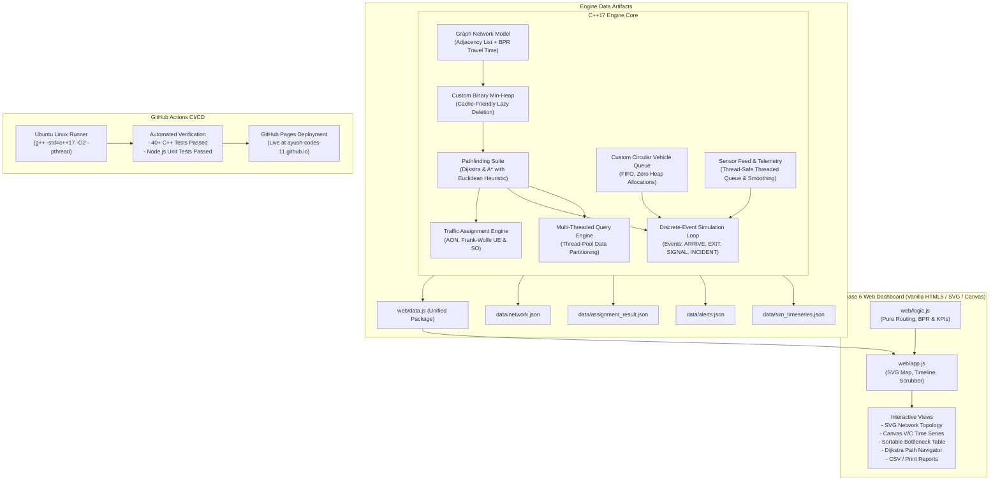

# Traffic Flow Analysis & Simulation System
**A High-Performance Road Network Assignment, Event-Driven Simulation, and Interactive Visualization Engine**  
*2nd-Year B.Tech Computer Science & Technology Capstone Project (MAIT)*

[](https://github.com/Ayush-Codes-11/Traffic_Flow_Analysis/actions/workflows/ci.yml)
[](https://ayush-codes-11.github.io/Traffic_Flow_Analysis/)
[](https://en.cppreference.com/w/cpp/17)
[](#zero-dependency-philosophy)

---

## 1. Project Overview

The **Traffic Flow Analysis & Simulation System** is an end-to-end transportation engineering and data structures platform designed to model, analyze, and optimize vehicular traffic across metropolitan road networks.

Key capabilities include:
- **Macroscopic Network Assignment**: Implements Bureau of Public Roads (BPR) link performance functions, All-or-Nothing (AON), Method of Successive Averages (MSA), and Frank-Wolfe convex optimization for **User Equilibrium (Wardrop's First Principle)** and **System Optimal (Wardrop's Second Principle)**.
- **Microscopic Discrete-Event Simulation**: Deterministic priority-queue event loop simulating vehicle physical movements, intersection queueing with headway delay, and cyclic traffic signal phases without busy waiting.
- **Dynamic Incident Management & Sensor Feed**: Real-time road closures, dynamic A* rerouting, sensor packet streaming with dropout detection, exponential moving average smoothing, and hysteresis threshold alerting.
- **High-Throughput Multi-Threading**: Multi-core parallel batch pathfinding engine utilizing `std::thread` to benchmark Dijkstra and A* query scalability across varying network dimensions.
- **Interactive Web Dashboard**: Standalone client-side application featuring SVG network topologies, interactive Dijkstra routing, time-series playback scrubber, bottleneck ranking, and printable engineering reports.

---

## 2. System Architecture



---

## 3. Project Requirements to Implementation Mapping

| # | Requirement Module | Implementation Files | Key Classes / Functions | Complexity / Specification |
|---|--------------------|----------------------|-------------------------|----------------------------|
| **1** | **Graph & BPR Data Model** | [`src/graph.h`](file:///c:/Users/ayush/OneDrive/Desktop/Traffic%20Flow%20Analysis/src/graph.h)<br>[`src/graph.cpp`](file:///c:/Users/ayush/OneDrive/Desktop/Traffic%20Flow%20Analysis/src/graph.cpp) | `Graph`, `Node`, `Edge`, `bpr_time()` | $O(1)$ edge cost evaluation; Robust JSON parser with syntax & bounds verification |
| **2** | **Custom Min-Heap & Pathfinding** | [`src/minheap.h`](file:///c:/Users/ayush/OneDrive/Desktop/Traffic%20Flow%20Analysis/src/minheap.h)<br>[`src/dijkstra.cpp`](file:///c:/Users/ayush/OneDrive/Desktop/Traffic%20Flow%20Analysis/src/dijkstra.cpp)<br>[`src/astar.cpp`](file:///c:/Users/ayush/OneDrive/Desktop/Traffic%20Flow%20Analysis/src/astar.cpp) | `MinHeap<T, Priority>`, `dijkstra()`, `astar()` | $O((V + E) \log V)$ with cache-friendly lazy deletion; A* admissible Euclidean speed heuristic |
| **3** | **Microscopic Simulation Engine** | [`src/vehicle.h`](file:///c:/Users/ayush/OneDrive/Desktop/Traffic%20Flow%20Analysis/src/vehicle.h)<br>[`src/vehicle_queue.h`](file:///c:/Users/ayush/OneDrive/Desktop/Traffic%20Flow%20Analysis/src/vehicle_queue.h)<br>[`src/simulation.h`](file:///c:/Users/ayush/OneDrive/Desktop/Traffic%20Flow%20Analysis/src/simulation.h)<br>[`src/simulation.cpp`](file:///c:/Users/ayush/OneDrive/Desktop/Traffic%20Flow%20Analysis/src/simulation.cpp) | `Vehicle`, `VehicleQueue`, `Simulation`, `Event` | Custom circular FIFO ring-buffer ($O(1)$ enqueue/dequeue); Non-busy-waiting signal phase checks |
| **4** | **Macroscopic Traffic Assignment** | [`src/assignment.h`](file:///c:/Users/ayush/OneDrive/Desktop/Traffic%20Flow%20Analysis/src/assignment.h)<br>[`src/assignment.cpp`](file:///c:/Users/ayush/OneDrive/Desktop/Traffic%20Flow%20Analysis/src/assignment.cpp) | `TrafficAssignment::run_aon()`, `run_msa()`, `run_frank_wolfe()` | Bisection line search for optimal step size $\lambda$; Solves User Equilibrium & System Optimal |
| **5** | **Dynamic Incidents & Sensor Feeds** | [`src/incidents.h`](file:///c:/Users/ayush/OneDrive/Desktop/Traffic%20Flow%20Analysis/src/incidents.h)<br>[`src/sensor_feed.h`](file:///c:/Users/ayush/OneDrive/Desktop/Traffic%20Flow%20Analysis/src/sensor_feed.h)<br>[`src/alerts.h`](file:///c:/Users/ayush/OneDrive/Desktop/Traffic%20Flow%20Analysis/src/alerts.h) | `IncidentManager`, `SensorFeed`, `AlertManager`, `ThreadSafeQueue` | Dynamic A* diversion threshold; Threaded producer-consumer ingestion; EMA sensor smoothing |
| **6** | **Web Visualization Dashboard** | [`web/index.html`](file:///c:/Users/ayush/OneDrive/Desktop/Traffic%20Flow%20Analysis/web/index.html)<br>[`web/style.css`](file:///c:/Users/ayush/OneDrive/Desktop/Traffic%20Flow%20Analysis/web/style.css)<br>[`web/app.js`](file:///c:/Users/ayush/OneDrive/Desktop/Traffic%20Flow%20Analysis/web/app.js)<br>[`web/logic.js`](file:///c:/Users/ayush/OneDrive/Desktop/Traffic%20Flow%20Analysis/web/logic.js) | `TrafficLogic`, `AppController` | Zero-dependency standalone SVG map, parallel opposing lanes, canvas line scrubber, print stylesheet |
| **7** | **Multi-Threaded Query Engine** | [`src/parallel.h`](file:///c:/Users/ayush/OneDrive/Desktop/Traffic%20Flow%20Analysis/src/parallel.h)<br>[`src/parallel.cpp`](file:///c:/Users/ayush/OneDrive/Desktop/Traffic%20Flow%20Analysis/src/parallel.cpp) | `create_grid_network()`, `run_parallel_benchmark()` | `std::thread` query partitioning across 5,000 OD pairs; Demonstrates linear scaling on 1,600-node grid |
| **8** | **CI/CD & Automated Verification** | [`.github/workflows/ci.yml`](file:///c:/Users/ayush/OneDrive/Desktop/Traffic%20Flow%20Analysis/.github/workflows/ci.yml) | GitHub Actions Pipeline | Ubuntu Linux headless compilation, 40+ assertion checks, node test validation, GitHub Pages automated push |

---

## 4. Build & Execution Instructions

### A. Linux, macOS, or Windows WSL2 (Recommended)
Compile and run directly using GNU Make and any C++17 compatible compiler:

```bash
# Clone the repository
git clone https://github.com/Ayush-Codes-11/Traffic_Flow_Analysis.git
cd Traffic_Flow_Analysis

# Build and execute all test suites & export web data
make clean
make
./traffic_sim
```

### B. Windows Local Execution & Smart App Control (SAC) Note
> [!WARNING]
> **Windows Smart App Control (SAC) Block Notice:**  
> On modern Windows 11 systems, Microsoft Smart App Control enforces cloud-signature verification. Newly compiled, unsigned local executables produced by local toolchains (MinGW/Clang) are blocked by the OS kernel with `WinError 4551: This file is blocked by Smart App Control`.
>
> **Recommended Solutions for Windows Users:**
> 1. **Windows Subsystem for Linux (WSL2):** Open a WSL terminal (`wsl`) and execute `make && ./traffic_sim` seamlessly.
> 2. **GitHub Actions CI (Automated):** Push commits to GitHub to execute the complete compilation and test harness in an isolated Ubuntu runner.
> 3. **GitHub Codespaces:** Open the repository in a cloud container with one click (`Code -> Open with Codespaces`).

### C. Viewing the Web Dashboard Locally
Because the C++ engine generates `web/data.js` containing `window.TRAFFIC_DATA = {...}`, you do not need to install Node, Python, or start a local web server:
- Simply **double-click** `web/index.html` in your file explorer to open it in any modern browser (`Chrome`, `Firefox`, `Edge`, `Safari`).
- Alternatively, view the production live version hosted at:  
  **[https://ayush-codes-11.github.io/Traffic_Flow_Analysis/](https://ayush-codes-11.github.io/Traffic_Flow_Analysis/)**

---

## 5. Visual Dashboard Features & Screenshots

```
+---------------------------------------------------------------------------------------------------+
|  [Header] Traffic Flow Analysis System | [Status: Data Loaded] [Download CSV] [Print Report]       |
+---------------------------------------------------------------------------------------------------+
|  [KPIs]  TSTT: 1,291.87 veh-hrs  |  Peak V/C: 1.041  |  Over-Cap: 1  |  Mode: User Eq. (UE)       |
+-------------------------------------------------------------+-------------------------------------+
|  [Toolbar] Scenario: [ UE ] [ SO ] [ AON ]                  |  [Route Navigator (Dijkstra)]       |
|  [Playback] [ |<< ] [ > / || ] [ >> ] [Time Slider] t=15m   |  From: Central_Station  To: Tech_Park|
+-------------------------------------------------------------+  Est. Travel Time: 8.07 min         |
|                                                             +-------------------------------------+
|  [Interactive SVG Network Topology Map]                    |  [Top Bottlenecks Table]            |
|  - Directed road segments color-coded by V/C                |  From      To     Flow   Cap    V/C   |
|  - Bidirectional lanes offset in parallel                   |  0 (Cent)  5(Biz) 2104   2000   1.052 |
|  - Live hover tooltips (Flow, Cap, V/C, BPR Time)           |  (Clicking highlights on map)       |
|                                                             +-------------------------------------+
|                                                             |  [Active Traffic Alerts Feed]       |
|  [Canvas 2D Time Series: Network V/C vs Time (t=0..60 min)] |  [CLOSURE] Edge 0->13 (t=5..40 min) |
|  - Incident window highlighted (t=5 to t=40 min)            |  [CONGESTION] Edge 0->5 V/C > 1.0   |
|  - Interactive vertical scrubber synchronized to map        |  (Clicking jumps timeline scrubber) |
+-------------------------------------------------------------+-------------------------------------+
```

---

## 6. Verification and Test Results

Every commit is built and verified via GitHub Actions CI across 43 automated assertion tests:
- **Phase 1**: Graph topology loading, JSON parser syntax & bounds safety, BPR analytical verification, Euclidean distance, road closure/reopen toggles.
- **Phase 2**: Custom MinHeap lazy deletion validation, Dijkstra vs analytical costs, A* admissible heuristic validation, bottleneck congestion rerouting.
- **Phase 3**: Vehicle circular queue ring-buffer integrity, single-vehicle headway, traffic signal green/red phase cycling, 20-vehicle and 50-vehicle throughput.
- **Phase 4**: Pigou network validation, Frank-Wolfe convex optimization convergence ($\text{RelGap} < 10^{-3}$), System Optimal TSTT $\le$ User Equilibrium TSTT.
- **Phase 5**: Dynamic incident injection, vehicle queue flushing on closure, sensor dropout detection, exponential moving average smoothing, hysteresis alerting, multi-threaded producer-consumer queue.
- **Phase 6**: Pre-Phase 6 accident scenarios (50 & 100 vehicles), JSON network and scenario export, Node.js unit tests for pure client logic.
- **Phase 7**: Multi-threaded batch query equivalence check, small vs large graph scaling benchmarks.

---

## 7. License & Academic Attribution
Developed as part of the 2nd-Year B.Tech Data Structures Capstone Project at Maharaja Agrasen Institute of Technology (MAIT).  
Academic License: Open for educational and research inspection.
